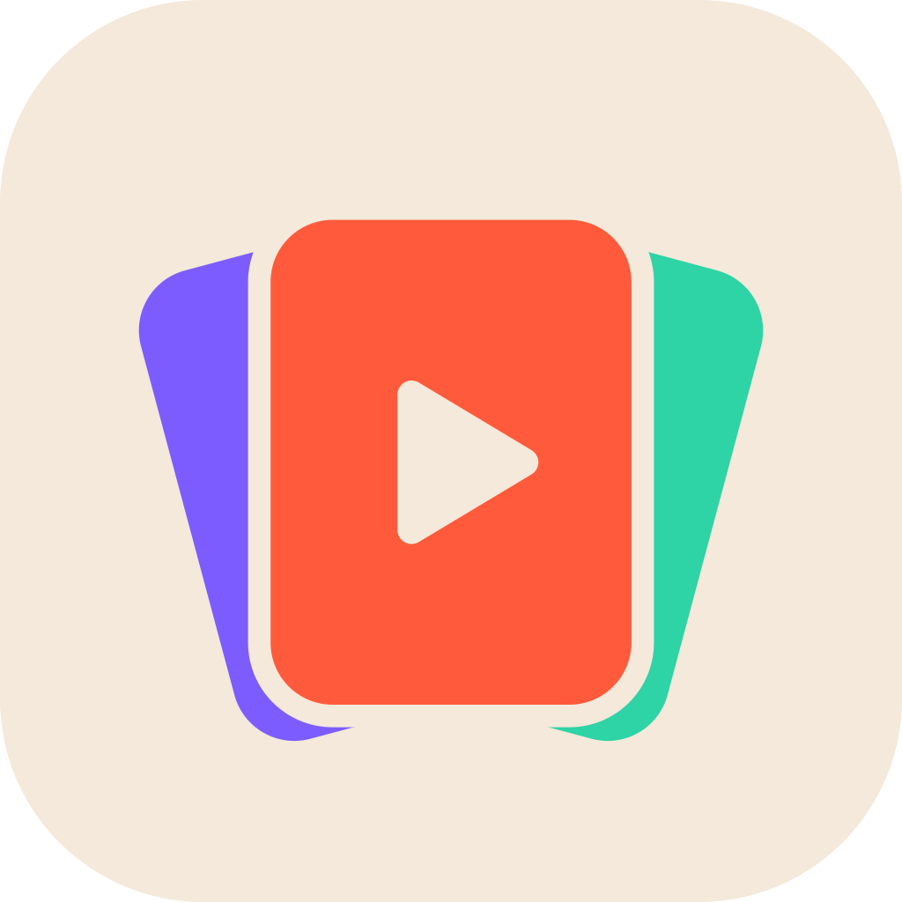

  

<h1 align="center">Socialboard</h1>

  A social mood board. Share a post from Instagram, TikTok, Facebook, X, YouTube, Threads or LinkedIn, 
  and your Mac reads it, sums it up and files it in the right board.

  
  
  
  

  

## What this repository is

The public release feed of Socialboard for Mac: signed, notarized builds and the update manifest the app checks. There is no source code here.

## Install

1. Download `Socialboard-<version>.zip` from the [latest release](../../releases/latest) and unzip it.
2. Move `Socialboard.app` to Applications and open it.
3. Sign in with your Lavder ID.

The app checks for new versions by itself. You can also choose **Check for Updates…** from the Socialboard menu.

## The engine

Posts are read on your own Mac, by a scheduled Claude Code session that runs on your Claude plan. The app installs it for you and asks before each step. It needs:

- Claude Code and Claude Desktop
- `ffmpeg`, and `whisper-cpp` if you want transcripts: `brew install ffmpeg whisper-cpp`

Without the engine the app still shows your boards.

## iPhone

The iPhone app and its Share extension are distributed through TestFlight.

---

Socialboard is a product of Lavder Enterprise S.R.L.
